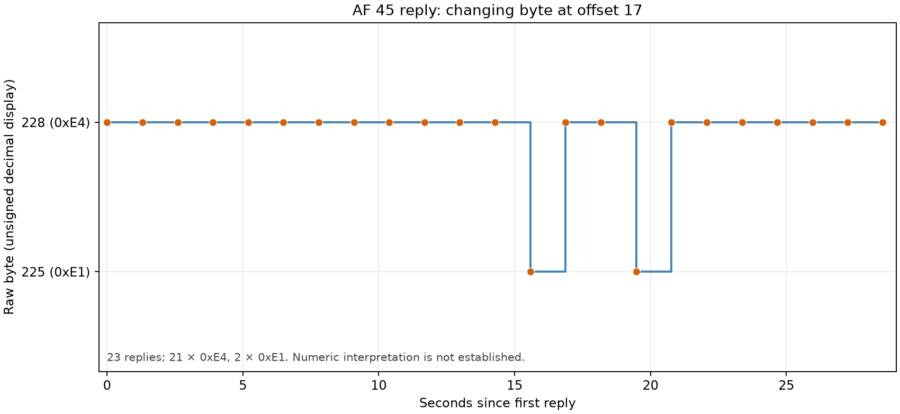

# Passive resistance-signal candidate capture

## What was captured

A 30-second passive TShark capture on both USBPcap root hubs, filtered to the StereoDrive controller (VID 0483, PID 5743, USB serial 206334AC5031; COM4, bus 2 address 3 at capture time). No commands were sent and no movement was requested.

## Observed

- `AF 45 00` query and 28-byte reply: 23 cycles at about 1.3-second intervals. The reply begins `45 01 02 03`; only byte offset 17 varied, between `E4` (21 replies) and `E1` (2 replies).
- `AF 53` query and 14-byte reply: 23 cycles; the reply was constant (`53 42 03 01 10 01 11 01 12 02 13 02 00 00`).
- No motor target or drill write appeared in this capture.

## Interpretation limits

The small changing AF 45 field is a candidate telemetry value. The capture did not include a controlled resistance change or a synchronized record of the displayed resistance value, so it does not establish that this field is resistance, nor its units or scaling. All other AF 45 fields also remain opaque.

`capture.pcapng` is the TShark-filtered evidence; `decoded.json` contains only parsed USB serial payloads. Hashes, precise UTC bounds, counts and limitations are in `metadata.json`.
